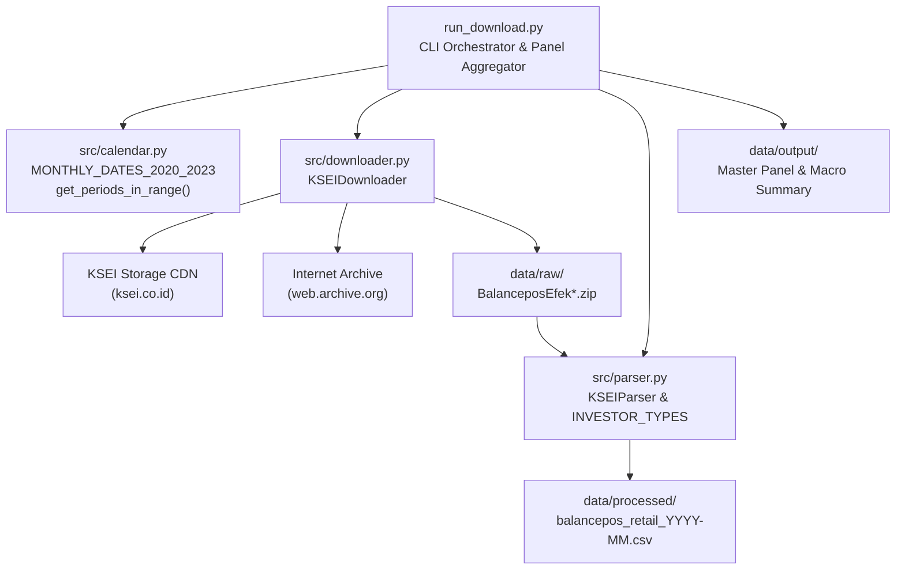

# ksei-ownership-pipeline

[](https://www.python.org/)
[](https://pandas.pydata.org/)
[](LICENSE)

An automated ETL pipeline in Python that retrieves, parses, and aggregates monthly **KSEI Securities Holding Composition (`BalanceposEfek`)** snapshots (2020-2023) to measure retail and institutional ownership across the Indonesia Stock Exchange (IDX).

---

## Why This Pipeline Exists

The Indonesia Central Securities Depository (KSEI) publishes monthly securities ownership files (`BalanceposEfekYYYYMMDD.zip`) containing shareholdings segmented by domestic and foreign investor categories. Working with these archives over multi-year periods involves three recurring obstacles:

1. **Irregular snapshot dates:** KSEI names each archive after the final IDX trading day of the month rather than the calendar month-end. Because of public holidays, collective leave days (*cuti bersama*), weekends, and year-end exchange closures, a naive month-end date generator fails on months like October 2020 (`20201027`) or June 2023 (`20230627`).
2. **Broken historical links & soft 404s:** Older snapshots on KSEI's primary storage often vanish or return an HTTP `200 OK` wrapping a Single-Page Application (SPA) HTML error page instead of a standard HTTP `404`.
3. **Malformed pipe-delimited headers:** The raw `.txt` files inside each archive use pipe (`|`) delimiters and contain duplicate `Total` column headers (the first representing domestic total holdings, the second representing foreign total holdings).

`ksei-ownership-pipeline` resolves these issues with a verified 48-month IDX trading calendar, binary ZIP validation with automatic fallback to the Internet Archive Wayback Machine, and deterministic schema normalization.

---

## Architecture & Data Pipeline

```mermaid
flowchart LR
    subgraph Calendar["1. Calendar Resolution"]
        CAL["src/calendar.py<br/>Verified IDX Month-End<br/>Trading Dates (2020-2023)"]
    end

    subgraph Ingestion["2. Dual-Source Ingestion"]
        CDN["Primary KSEI Storage<br/>(ksei.co.id)"]
        WB["Wayback Machine Fallback<br/>(web.archive.org)"]
        VAL{"Binary & CRC<br/>ZIP Validation"}
        RAW[("data/raw/<br/>BalanceposEfek*.zip")]
    end

    subgraph Transformation["3. Normalization & Metrics"]
        PARSE["src/parser.py<br/>Pipe-Delimited Parser &<br/>Duplicate Header Resolver"]
        CALC["Ownership Calculator<br/>Retail vs. Institutional<br/>Shares & IDR Valuation"]
        PROC[("data/processed/<br/>balancepos_retail_YYYY-MM.csv")]
    end

    subgraph Aggregation["4. Panel & Macro Outputs"]
        PANEL[("Master Security Panel<br/>ksei_retail_balancepos_*.csv")]
        MACRO[("Monthly Market Summary<br/>ksei_retail_monthly_summary_*.csv")]
    end

    CAL --> CDN
    CDN --> VAL
    CDN -. "HTTP error / HTML soft-404" .-> WB
    WB --> VAL
    VAL -- "Atomic write (>10KB, valid .txt)" --> RAW
    RAW --> PARSE
    PARSE --> CALC
    CALC --> PROC
    PROC --> PANEL
    PROC --> MACRO
```



### Pipeline Stages

1. **Calendar Resolution ([src/calendar.py](src/calendar.py))**
   Maps `YYYY-MM` periods to exact IDX month-end settlement dates (`YYYYMMDD`), plus a backward-stepping candidate generator (`candidate_dates_for_month`) for extending the pipeline to new years.
2. **Resilient Ingestion ([src/downloader.py](src/downloader.py))**
   Queries KSEI's primary storage with polite rate limiting. Inspects `Content-Type` headers to reject SPA HTML soft-404 responses, writes downloads to temporary `.tmp` files, and runs `zipfile.ZipFile.testzip()` CRC checks before promoting archives to `data/raw/`. Automatically falls back to the Wayback Machine if the primary server fails.
3. **Schema Normalization & Retail Calculation ([src/parser.py](src/parser.py))**
   Streams the inner pipe-delimited `.txt` file in memory, disambiguates duplicate `Total` columns into `Local Total` and `Foreign Total`, converts formatted numeric strings, standardizes dates to ISO `YYYY-MM-DD`, and computes domestic/foreign individual (`Local ID`, `Foreign ID`) ownership shares and IDR market values.
4. **Panel Consolidation ([run_download.py](run_download.py))**
   Caches monthly parsed slices in `data/processed/` for idempotent re-runs and concatenates the requested date window into a security-level panel dataset and a market-wide monthly time series in `data/output/`.

### System Architecture & Module Map



---

## Project Structure

```text
ksei-ownership-pipeline/
├── src/
│   ├── __init__.py          # Package version metadata
│   ├── calendar.py          # Verified 2020-2023 IDX snapshot dates & candidate date generator
│   ├── downloader.py        # Dual-source HTTP client with SPA soft-404 rejection & ZIP CRC checks
│   └── parser.py            # Pipe-delimited parser, header normalizer & retail ownership formulas
├── data/                    # Created automatically at runtime (git-ignored)
│   ├── raw/                 # Cached BalanceposEfekYYYYMMDD.zip archives
│   ├── processed/           # Monthly parsed CSVs (balancepos_retail_YYYY-MM.csv)
│   └── output/              # Consolidated multi-year panel and monthly macro summary CSVs
├── run_download.py          # Main CLI entry point
├── requirements.txt         # Runtime dependencies (pandas, requests)
├── LICENSE                  # MIT License
└── README.md                # Documentation
```

---

## Quick Start

### 1. Prerequisites

Requires Python 3.9 or newer. Install dependencies in a virtual environment:

```bash
python -m venv .venv
# Windows (PowerShell)
.\.venv\Scripts\Activate.ps1
# Linux / macOS
source .venv/bin/activate

pip install -r requirements.txt
```

### 2. Run the Full Pipeline (2020-2023)

Execute the default 48-month equity pipeline:

```bash
python run_download.py
```

Cached archives in `data/raw/` and parsed monthly files in `data/processed/` are reused automatically on subsequent runs.

### 3. CLI Reference & Custom Execution

| Flag | Default | Description |
|---|---|---|
| `--start-year` | `2020` | Starting year filter (`YYYY`) |
| `--end-year` | `2023` | Ending year filter (`YYYY`) |
| `--start-period` | `2020-01` | Exact starting month (`YYYY-MM`), overrides `--start-year` |
| `--end-period` | `2023-12` | Exact ending month (`YYYY-MM`), overrides `--end-year` |
| `--all-securities` | `False` | Keep all security types (bonds, warrants, ETFs, mutual funds) instead of filtering to `EQUITY` |
| `--force` | `False` | Bypass local cache and re-download / re-parse all target months |
| `--delay` | `0.5` | Delay in seconds between HTTP requests |
| `--output-dir` | `./data` | Target base directory for `raw/`, `processed/`, and `output/` |

**Common examples:**

```bash
# Run for a specific year range (2021 to 2022)
python run_download.py --start-year 2021 --end-year 2022

# Run for a specific quarter (Q1 2020)
python run_download.py --start-period 2020-01 --end-period 2020-03

# Include all security classes (Corporate Bonds, Mutual Funds, Warrants, Equity)
python run_download.py --all-securities

# Force fresh download and re-computation
python run_download.py --force
```

---

## Programmatic Usage (Python API)

You can import `KSEIDownloader` and `KSEIParser` directly into research notebooks or downstream data pipelines:

```python
from pathlib import Path
from src.calendar import get_periods_in_range
from src.downloader import KSEIDownloader
from src.parser import KSEIParser

downloader = KSEIDownloader(raw_dir=Path("./data/raw"), delay_seconds=0.5)
parser = KSEIParser(equity_only=True)

for period_ym, snapshot_date in get_periods_in_range(start_period="2023-01", end_period="2023-03"):
    ok, zip_path, status = downloader.download_period(snapshot_date)
    if ok and zip_path:
        df_month = parser.parse_zip(zip_path)
        print(f"{period_ym}: {len(df_month)} equities parsed ({status})")
```

---

## Data Dictionary & Methodology

### Investor Category Codes (`INVESTOR_TYPES`)

KSEI classifies holdings separately for `Local` (domestic) and `Foreign` investors across nine categories:

| Code | Category Name | Grouping in Pipeline |
|---|---|---|
| `ID` | Individual (*Individu / Ritel*) | **Retail** (`Local ID` + `Foreign ID`) |
| `IS` | Insurance (*Asuransi*) | Institutional |
| `CP` | Corporate (*Korporasi*) | Institutional |
| `PF` | Pension Fund (*Dana Pensiun*) | Institutional |
| `IB` | Financial Institution / Bank (*Lembaga Keuangan / Bank*) | Institutional |
| `MF` | Mutual Fund (*Reksadana*) | Institutional |
| `SC` | Securities Company (*Perusahaan Efek*) | Institutional |
| `FD` | Foundation (*Yayasan*) | Institutional |
| `OT` | Others (*Lainnya*) | Institutional |

### 1. Security-Level Panel (`ksei_retail_balancepos_<START>_<END>.csv`)

Contains one row per security per month, preserving all raw KSEI investor columns alongside derived retail ownership metrics:

| Column | Type | Formula / Description |
|---|---|---|
| `Date` | `string` | Standardized ISO snapshot date (`YYYY-MM-DD`) |
| `Code` | `string` | IDX ticker symbol (e.g., `BBCA`, `BBRI`, `TLKM`) |
| `Type` | `string` | Security classification (`EQUITY` by default) |
| `Sec. Num` | `float` | Total listed shares recorded on the exchange |
| `Price` | `float` | Month-end closing price in IDR |
| `Local ID` / `Foreign ID` | `float` | Shares held by domestic / foreign individual investors |
| `Local Total` / `Foreign Total` | `float` | Total scriptless shares held in KSEI by domestic / foreign investors |
| `total_shares_ksei` | `float` | `Local Total + Foreign Total` |
| `retail_local_shares` | `float` | Alias for `Local ID` |
| `retail_foreign_shares` | `float` | Alias for `Foreign ID` |
| `retail_total_shares` | `float` | `Local ID + Foreign ID` |
| `retail_prop_ksei_pct` | `float` | `(retail_total_shares / total_shares_ksei) * 100` (4 decimal places) |
| `retail_prop_listed_pct` | `float` | `(retail_total_shares / Sec. Num) * 100` (4 decimal places) |
| `retail_local_share_of_local_pct` | `float` | `(Local ID / Local Total) * 100` (4 decimal places) |
| `retail_local_value_idr` | `int64` | `Local ID * Price` (IDR) |
| `retail_foreign_value_idr` | `int64` | `Foreign ID * Price` (IDR) |
| `retail_total_value_idr` | `int64` | `retail_total_shares * Price` (IDR) |
| `total_market_value_idr` | `int64` | `total_shares_ksei * Price` (IDR) |

> **Note on KSEI Shares vs. Listed Shares (`Sec. Num`):** Scriptless shares deposited in KSEI (`total_shares_ksei`) can be smaller than total listed shares (`Sec. Num`) when founders, strategic shareholders, or the government hold physical/non-scriptless shares (*saham warkat*) outside KSEI custody (common in state-owned banks and recent IPOs). `retail_prop_ksei_pct` measures retail share of scriptless free float in KSEI, whereas `retail_prop_listed_pct` measures retail share against total issued capital.

### 2. Monthly Market Summary (`ksei_retail_monthly_summary_<START>_<END>.csv`)

Aggregates ownership across all equities for each month to track macro retail participation:

| Column | Description |
|---|---|
| `period` | Month identifier (`YYYY-MM`) |
| `snapshot_date` | Exact KSEI settlement snapshot date (`YYYY-MM-DD`) |
| `equities_count` | Number of active equity tickers in the snapshot |
| `total_ksei_shares` | Sum of `total_shares_ksei` across all equities |
| `total_retail_shares` | Sum of `retail_total_shares` across all equities |
| `local_retail_shares` | Sum of domestic individual shares (`Local ID`) |
| `foreign_retail_shares` | Sum of foreign individual shares (`Foreign ID`) |
| `market_retail_prop_pct` | Share-weighted aggregate retail ownership % (`total_retail_shares / total_ksei_shares * 100`) |
| `total_market_value_idr` | Total IDR market capitalization of KSEI-deposited shares |
| `total_retail_value_idr` | Total IDR market value of retail holdings |
| `market_retail_value_pct` | Value-weighted aggregate retail ownership % (`total_retail_value_idr / total_market_value_idr * 100`) |
| `avg_stock_retail_prop_pct` | Equal-weighted cross-sectional mean of `retail_prop_ksei_pct` across tickers |

---

## Extending to New Periods (2024+)

To add newer months beyond 2023:
1. Open [src/calendar.py](src/calendar.py) and append the `"YYYY-MM": "YYYYMMDD"` key-value pairs to `MONTHLY_DATES_2020_2023` corresponding to the final IDX trading day of each month.
2. If you do not know the exact last trading day of a month, call `candidate_dates_for_month(year, month)` in [src/calendar.py](src/calendar.py#L85-L94) to probe the last 6 calendar days of the month against `KSEIDownloader.download_period()`.

---

## License

Released under the [MIT License](LICENSE). Data retrieved by this tool originates from public disclosures by PT Kustodian Sentral Efek Indonesia (KSEI).
